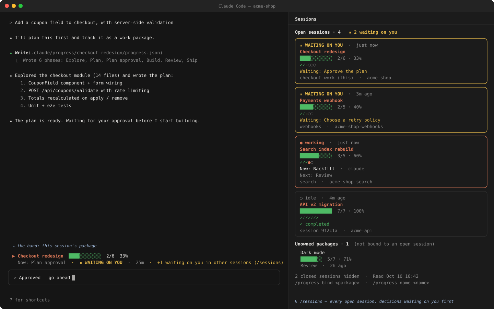
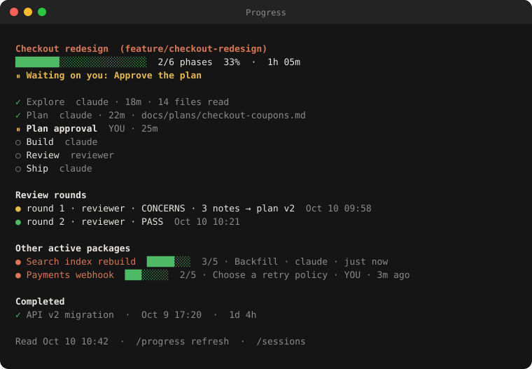

# session-progress

**English** · [Türkçe](README.tr.md)

A Claude Code plugin that shows how your work is going, **per session**:

<p align="center">
  
</p>

- **Band above the prompt:** the work package this session is on. It shows a bar, the current phase, and who the work is waiting on.
  When a decision is waiting on you it turns amber.
- **`/sessions` panel:** every open Claude Code session as a card, sessions waiting on you first. Each card shows the package, progress,
  a phase strip (✓ ● ⏸ ○), what it waits on or the current and next phase, its subagents, and the session's name, checkout and branch
  (worktrees marked). Packages no open session is working on are listed under it. The command opens and closes it; it also opens by
  itself when another session starts waiting on you, until you close it in that session.
- **Subagents:** the band and the cards show a session's subagents — how many run, finished or failed, and the running ones' task
  labels. A session whose subagent runs in the background counts as working.
- **`/progress` panel:** the session's package in full. It lists phases with owner, duration, notes, metrics and references, then review
  rounds, other active packages and completed ones.
- **Notifications:** a toast when a phase of your package finishes or a decision moves to you, and when **another** session starts
  waiting on you: a permission prompt, a question or a plan to approve opens there, or its package's decision moves to you.
- **Open dialogs count as waiting:** a session showing a permission prompt, a question or a plan to approve is listed as waiting on you
  in `/sessions` and in the band's counter, even when it is bound to no package.
- **Other projects (off by default):** turn them on with `/sessions all` and `/sessions` also shows your open sessions in other
  projects, with their packages' progress, and a toast tells you when one of them starts waiting on you. See
  [Sessions in other projects](#sessions-in-other-projects).

It is built for running several sessions at once (worktrees, parallel features, agents) and seeing at a glance which one needs you.

<p align="center">
  
</p>

### A typical flow

1. You ask for a multi-step change. Claude writes `.progress/<package>/progress.json` with its plan as phases; the band appears
   above the prompt for that session.
2. Claude moves through the phases and updates the file; the bar and the current phase follow.
3. When Claude needs your decision it marks the phase `waiting-user`: the band turns amber, a toast says what is waiting, and the
   session moves to the top of `/sessions` in every other session too.
4. With several sessions open (one per worktree, say), `/sessions` shows which one is working, which one waits on you, and which is
   done.

All names in these pictures are invented examples.

## Install

```
/plugin install session-progress --marketplace oguzhanselamoglu/session-progress
```

Type it in a terminal session; answer `y` to add the marketplace and pick the user scope. With the user scope it also loads in the
desktop app's Code tab. Claude Code 2.1.287 or later.

**Where it runs:** Claude Code (terminal and the desktop app's Code tab); the band and panels are Claude Code interface. Tested on macOS;
Linux should work the same, Windows paths are handled but not yet tried on Windows — reports are welcome.

## Quick start

1. In your repository: `/progress init` — creates `.progress/` (commit it with the project). If the project has a `CLAUDE.md`,
   it offers to add the line that makes tracking automatic; otherwise it prints it (see [Using it](#using-it)).
2. Ask Claude for something with a few steps and say *"plan this and track it with session-progress"*. Claude writes the package file;
   the band appears above the prompt.
3. Open `/sessions` in any session to see every open session, the ones waiting on you first.

## Using it

### Give the work as a list and ask for tracking

The bundled skill teaches Claude how to write the package file, but Claude decides when to use it. Ask for tracking in the prompt and it
always does:

```
Do these and track them with session-progress:
- Add e-mail validation to the login form
- Translate the error messages
- Write the tests
- Bring it to me for approval before merging
```

Each item becomes a **phase**. The band shows the title, a bar, `done/total` and the current phase; it moves as Claude starts and
finishes phases, and a toast tells you when one is done. Phase titles are written in the language you speak with Claude.

### Ask for your approval as a step

An item like *"bring it to me for approval"* becomes a phase waiting on you. When Claude reaches it, it stops: the band turns amber
(**WAITING ON YOU**), a toast says what is waiting, and the session moves to the top of `/sessions` in every other session.

### When a file does not match

A package whose `progress.json` does not match the schema is shown as an error line instead of its progress. When Claude writes such a
file, the plugin tells it right away (the file and the first problem), so it fixes the file in the same turn.

### Make it automatic in a project

With this line in the project's `CLAUDE.md`, Claude tracks multi-step work there without being asked (the skill follows a project's
own rules first):

```md
Track multi-step work (3+ steps) with session-progress.
```

`/progress init` offers to add it, in the language you use, to an existing `CLAUDE.md` (or `.claude/CLAUDE.md`): it shows the exact
line and asks first; only when you say yes is it appended at the end — never twice, and never asked about when the file already
mentions session-progress. Declined, it prints the line for you instead. It never creates a `CLAUDE.md`; without one it prints the
line for you to add. It takes effect from the next session.

### Several sessions

- Name each session so the cards are easy to tell apart: `/progress name API work`.
- Open `/sessions` in any of them: sessions waiting on you come first, with what they wait for (a package's decision, a permission
  prompt, a question or a plan to approve). When another session starts waiting on you, a toast tells you here too.
- Sessions in different worktrees of one repository see each other. Sessions in other repositories show up only when you turn on
  other projects (next section).

### Sessions in other projects

**Off by default.** `/sessions` shows the sessions of the repository you are in. To follow your sessions in other projects too, turn
other projects on, from any session:

```
/sessions all      # on   (Türkçe: /oturumlar tümü)
/sessions this     # off  (Türkçe: /oturumlar bu)
```

The choice is yours, not the project's: it is kept in the plugin's store and applies to all your sessions (the ones already open pick it
up within 30 seconds). Typing either language's word works.

While it is on:

- `/sessions` lists, below this project's sessions, an **Other projects** section: each project with open sessions, and each session as
  the same card as here (status, the dialog waiting on you, the bound package with its progress bar, phases, what runs now and what is
  next, subagents, branch). Projects with something waiting on you come first, and a line at the top of the panel tells you so.
- When a session in another project starts waiting on you (a permission prompt, a question, a plan to approve, or its package's
  decision), you get a toast naming the project and the session: `⏸ shop › API work: waiting on you — a question`. The band's
  "waiting on you in other sessions" counter counts them too, and the sessions panel opens by itself as it does for this project.
- To be seen by the others, each project that has an open session writes one small file under your Claude Code configuration folder:
  `~/.claude/session-progress/projects/<folder>-<hash>.json` (in `$CLAUDE_CONFIG_DIR` when you set one). It holds the project's path,
  its packages folder, its accepted schema names and the time it was last seen — nothing else. A project whose sessions are all closed
  stops being shown after a few minutes.

The panel's last line always says whether other projects are on and how to switch. Turning them off stops all writing outside the
project at once (in the other open sessions, at their next heartbeat). The project files that are left are ignored once they are a few
minutes old, and you can delete `~/.claude/session-progress/` at any time.

Only projects that use the plugin (they have a packages folder) take part, and only sessions running a version with this feature.

### Tips

- 3–8 meaningful items work best: the bar moves by finished phases, so very fine steps add noise.
- One package per piece of work. A finished package is never picked up again; new work gets a new package.
- `/progress` shows the package in full: each phase's owner, duration, notes and references.

## How it works

Each package is one JSON file: `<packagesDir>/<package>/progress.json`. The agent writes it as the work moves through its phases. The
plugin ships a skill that tells Claude when and how to write it, so in most projects nothing else is needed.

A session **binds** to a package when its own tool call writes that package's `progress.json`. It binds through Write/Edit, or through
a Bash command that names the path and changes the file. Reading a file never binds. A completed package is not bound automatically.
You can also bind by hand with `/progress bind <package>`.

Every session keeps a small record under `<main repo>/.git/session-progress/sessions/`. The `.git` folder is shared by all worktrees and
never tracked. The sessions panel is built from these records. A record is refreshed at session start, at each turn start and end, when a dialog opens
or closes, when a subagent starts or ends, and every 30 s. Other sessions' records are read every 5 s (a record whose file did not change
is not read again), so a dialog in one session reaches the others within seconds. A session silent for 3 minutes, or one that ended,
counts as closed. Records are only written in repositories that have a
packages folder, so other projects stay untouched. With other projects on (`/sessions all`, off by default), each such project also
leaves one small file under your Claude Code configuration folder, and each session reads the other projects' records the same way.

### What it reads and writes

Everything stays on your machine: the plugin makes no network requests and reads no credentials.

| | Path | Why |
|---|---|---|
| reads | `<packagesDir>/*/progress.json` in the main checkout and every worktree | the packages it shows |
| reads | `.claude/session-progress.json` | the project's settings |
| reads | `.git` (file or folder) and `.git/worktrees/*/gitdir` | to find the main checkout and its worktrees |
| reads | the checkout's git `HEAD` | its branch, shown on the session's card |
| writes | `.git/session-progress/sessions/<session id>.json` | one small record per session: name, checkout, bound package, last signal, branch, whether it is a worktree, the kind of dialog open on you with the tool's name (`permission: Bash`; never the command or the tool's input), and its subagents' short task labels and states (never their prompts). Git ignores unknown folders inside `.git`; nothing is committed. Written only in repositories that have a packages folder. |
| writes | `<packagesDir>/README.md` | only when you run `/progress init`, and never over an existing folder |
| reads | `~/.claude/session-progress/projects/*.json`, then each listed project's `.git/session-progress/sessions/*.json` and the `progress.json` its open sessions are bound to | only while other projects are on (`/sessions all`): the sessions and packages of your other projects |
| reads | the `CLAUDE_CONFIG_DIR`, `HOME` and `USERPROFILE` environment variables | to find your Claude Code configuration folder |
| writes | `~/.claude/session-progress/projects/<folder>-<hash>.json` | only while other projects are on: the project's path, its packages folder, its accepted schema names and when it was last seen, so your sessions in other projects can find it |
| writes | `CLAUDE.md` or `.claude/CLAUDE.md` | only when you run `/progress init`, the file already exists and you say yes when asked: one line is appended (see [Using it](#using-it)); a file that mentions session-progress is left as it is |

Of these, only `CLAUDE.md` is a file Claude follows as instructions, and the plugin adds to it only on your yes. The session records under
`.git/session-progress/` are read by the plugin alone (every open session's copy of it); no other tool runs or obeys them.

Hooks: `tool.call` on Write, Edit, NotebookEdit and Bash only **watches** whether a call wrote a package's `progress.json`, to bind
the session; it never changes, delays or blocks a call. `session.start`, `session.end`, `turn.start` and `turn.complete` keep the
session record current. `classic.Notification` only **watches** Claude Code's own notice that a permission prompt is showing
(`permission_prompt`; the tool's name is taken from it, nothing else), and `tool.call` on every tool only **watches** when a question or a
plan to approve opens and when a call ends, to mark the session as waiting. **No hook of the plugin runs on a permission check:** none
answers, changes, delays or blocks a prompt or a call, and the notice passes on untouched. The same `tool.call` on
Agent and `classic.SubagentStop` only **watch** when a subagent starts and ends; SubagentStop's result passes on untouched.
`classic.PostToolUse` checks a `progress.json` the call just **wrote** (never one it only read): if it does not match the schema, it adds
one line for Claude naming the file and the first problem, so the writer fixes it in the same turn; the tool's result is never changed. `ui.render`
draws the band and the two panels. The plugin registers two commands (`/progress`, `/sessions`;
in Turkish `/ilerleme`, `/oturumlar`) and keeps your language and other-projects choices in its own store.

### `progress.json`

```json
{
  "schema": "session-progress-v1",
  "package": "login-flow",
  "title": "Login flow with SMS code",
  "updatedAt": "2026-10-10T09:41:00Z",
  "phases": [
    { "id": "plan", "title": "Plan", "status": "done", "startedAt": "2026-10-10T08:00:00Z", "finishedAt": "2026-10-10T08:20:00Z" },
    { "id": "approve", "title": "Plan approval", "status": "waiting-user", "owner": "user" },
    { "id": "build", "title": "Build", "status": "pending", "owner": "claude" }
  ],
  "waitingOn": { "who": "user", "what": "Approve the plan" }
}
```

- **Statuses:** `pending`, `active`, `waiting-user`, `waiting-external`, `blocked`, `done`, `skipped`.
- **Owners:** `owner` and `waitingOn.who` are free labels. `user` means you and is highlighted.
- **Optional per phase:** `startedAt`, `finishedAt`, `note`, `refs`, `metrics`.
- **Optional per package:** `branch`, `worktree`, and `audits` (review rounds: `round`, `by`, `verdict`, `findings`, `closedBy`, `at`).

The full rules are in [`skills/session-progress/SKILL.md`](skills/session-progress/SKILL.md).

## Configure

**Per project:** add `.claude/session-progress.json` at the repository root and commit it. Every field is optional.

```json
{
  "packagesDir": "docs/work-packages",
  "ownerLabels": { "qa": "QA team", "claude": "Claude" }
}
```

| Field | Default | Meaning |
|---|---|---|
| `packagesDir` | `.progress` | Folder holding one sub-folder per package, relative to the root. |
| `ownerLabels` | none | Display names for owner labels. `user` is always shown as YOU. |
| `schemaAliases` | none | Other `schema` names to read as `session-progress-v1` (files from before a rename). |

## Language

English is the default. Each person can switch, and the choice is kept for all their later sessions:

```
/progress language tr     # to Türkçe
/ilerleme dil en          # back to English
```

The band, both panels and the command names switch at once in the current session.

| Language | Commands | Sub-commands |
|---|---|---|
| English | `/progress`, `/sessions` | `/progress`: `init` · `refresh` · `bind <package>` · `unbind` · `name <name>` · `language en\|tr` — `/sessions`: `all` · `this` |
| Türkçe | `/ilerleme`, `/oturumlar` | `/ilerleme`: `kur` · `yenile` · `bağla <paket>` · `çöz` · `ad <ad>` · `dil en\|tr` — `/oturumlar`: `tümü` · `bu` |

Sub-commands are understood in both languages, so typing the other language's word still works. What Claude writes into
`progress.json` (titles, notes) follows the language you talk to it in.

**Adding a language:** every text is in [`hooks/i18n.ts`](hooks/i18n.ts), one typed dictionary per language. Copy `en`, translate it,
choose the command names, and add the code to `LANGS`. The type checker reports any text you missed. Pull requests are welcome.

## Develop

```bash
claude plugin validate .
claude plugin test .
claude --plugin-dir .            # run a session with the working copy
```

The pure core has no access to the engine and is unit-tested directly:

- `hooks/model.ts`: schema, progress, durations, notifications.
- `hooks/sessions.ts`: session records, binding, ordering.
- `hooks/i18n.ts`: every text, in both languages.

The hooks live in `hooks/register.tsx`. The README pictures are drawn from invented data by
`python3 scripts/make-readme-images.py`; run it again after a visible change.

## License

MIT
