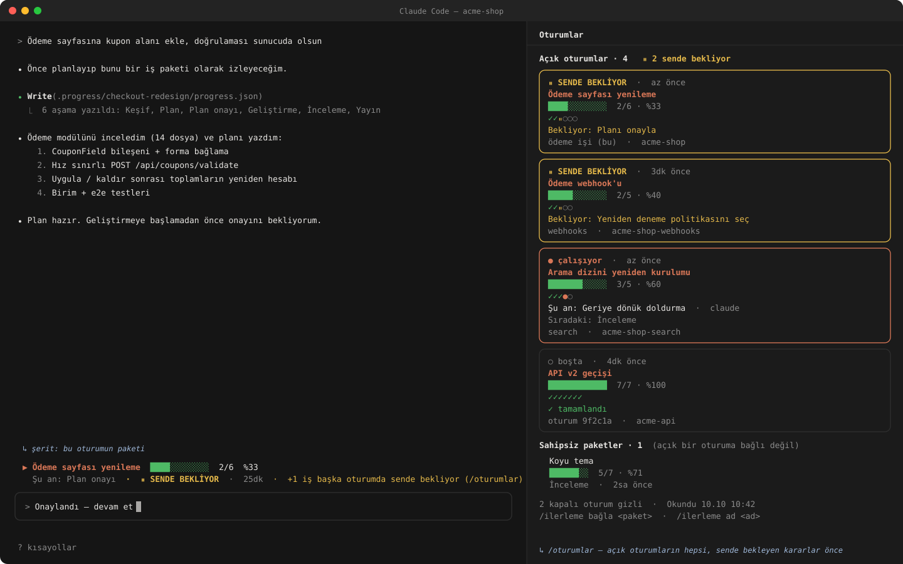
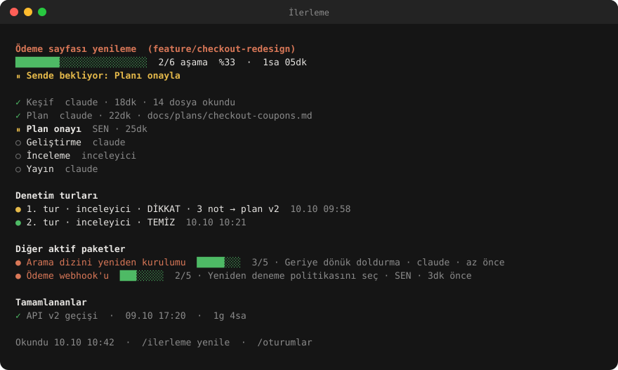

# session-progress

[English](README.md) · **Türkçe**

İşinin nasıl ilerlediğini **oturum bazında** gösteren bir Claude Code eklentisi:

<p align="center">
  
</p>

- **Prompt üstündeki şerit:** bu oturumun üzerinde çalıştığı iş paketi. Bir çubuk, şu anki aşama ve işin kimi beklediği görünür. Karar
  sende bekliyorsa sarıya döner.
- **`/oturumlar` paneli:** açık her Claude Code oturumu bir kart; sende bekleyenler en üstte. Her kartta paket, ilerleme, aşama şeridi
  (✓ ● ⏸ ○), neyi beklediği ya da şu anki ve sıradaki aşama, oturumun adı ve klasörü vardır. Hiçbir açık oturumun üzerinde çalışmadığı
  paketler altta listelenir.
- **`/ilerleme` paneli:** oturumun paketi tüm ayrıntısıyla. Aşamalar sahibi, süresi, notları, ölçümleri ve bağlantılarıyla; ardından
  denetim turları, diğer aktif paketler ve tamamlananlar.
- **Bildirimler:** paketinin bir aşaması bitince ya da karar sana geçince kısa bir bildirim.

Aynı anda birden çok oturumla (worktree'ler, paralel özellikler, ajanlar) çalışırken hangisinin seni beklediğini tek bakışta görmek
için yapıldı.

<p align="center">
  
</p>

### Tipik bir akış

1. Çok adımlı bir değişiklik istersin. Claude planını aşamalar hâlinde `.progress/<paket>/progress.json` dosyasına yazar; o
   oturumun prompt'unun üstünde şerit belirir.
2. Claude aşamalarda ilerledikçe dosyayı günceller; çubuk ve şu anki aşama onu izler.
3. Kararın gerektiğinde Claude aşamayı `waiting-user` yapar: şerit sarıya döner, bir bildirim neyin beklediğini söyler ve oturum diğer
   oturumlardaki `/oturumlar` panelinde de en üste çıkar.
4. Birden çok oturum açıkken (örneğin her worktree için bir tane) `/oturumlar` hangisinin çalıştığını, hangisinin seni beklediğini ve
   hangisinin bittiğini gösterir.

Görsellerdeki bütün adlar uydurma örneklerdir.

## Kurulum

```
/plugin install session-progress --marketplace oguzhanselamoglu/session-progress
```

Bir terminal oturumunda yaz; marketi eklemek için `y` de ve kullanıcı kapsamını seç. Kullanıcı kapsamında masaüstü uygulamasının Code
sekmesinde de yüklenir. Claude Code 2.1.287 ya da üstü gerekir.

Arayüz ilk açılışta İngilizcedir; Türkçeye geçmek için bir kez şunu yaz:

```
/progress language tr
```

**Nerede çalışır:** Claude Code (terminal ve masaüstü uygulamasının Code sekmesi); şerit ve paneller Claude Code arayüzüdür. macOS'ta
denendi; Linux'ta aynı çalışması beklenir, Windows yolları destekleniyor ama Windows'ta henüz denenmedi — geri bildirimlere açığız.

## Hızlı başlangıç

1. Deponda: `/ilerleme kur` — `.progress/` klasörünü oluşturur (projeyle birlikte commit'le).
2. Claude'dan birkaç adımlı bir iş iste ve *"bunu planla ve session-progress ile takip et"* de. Claude paket dosyasını yazar; şerit
   prompt'un üstünde belirir.
3. Herhangi bir oturumda `/oturumlar` ile tüm açık oturumları gör; seni bekleyenler en üstte.

## Nasıl çalışır

Her paket tek bir JSON dosyasıdır: `<packagesDir>/<paket>/progress.json`. İş aşamalarda ilerledikçe ajan bu dosyayı yazar. Eklentiyle
gelen beceri Claude'a dosyayı ne zaman ve nasıl yazacağını söyler; çoğu projede başka bir şey gerekmez.

Bir oturum, kendi araç çağrısı bir paketin `progress.json`'unu yazdığında o pakete **bağlanır**. Write/Edit ile ya da yolu adıyla anan ve
dosyayı gerçekten değiştiren bir Bash komutuyla bağlanır. Dosyayı okumak bağlamaz. Tamamlanmış pakete otomatik bağlanılmaz. Elle
bağlamak için `/ilerleme bağla <paket>`.

Her oturum `<ana depo>/.git/session-progress/sessions/` altında küçük bir kayıt tutar. `.git` klasörü bütün worktree'lerde ortaktır ve
git onu izlemez. Oturumlar paneli bu kayıtlardan kurulur. Kayıt oturum başında, her turun başında ve sonunda ve 30 saniyede bir
tazelenir. 3 dakikadır ses vermeyen ya da kapanmış oturum kapalı sayılır. Kayıtlar yalnızca paket klasörü olan depolarda yazılır; başka
projelere dokunulmaz.

### `progress.json`

```json
{
  "schema": "session-progress-v1",
  "package": "login-flow",
  "title": "SMS kodlu giriş akışı",
  "updatedAt": "2026-10-10T09:41:00Z",
  "phases": [
    { "id": "plan", "title": "Plan", "status": "done", "startedAt": "2026-10-10T08:00:00Z", "finishedAt": "2026-10-10T08:20:00Z" },
    { "id": "approve", "title": "Plan onayı", "status": "waiting-user", "owner": "user" },
    { "id": "build", "title": "Geliştirme", "status": "pending", "owner": "claude" }
  ],
  "waitingOn": { "who": "user", "what": "Planı onayla" }
}
```

- **Durumlar:** `pending`, `active`, `waiting-user`, `waiting-external`, `blocked`, `done`, `skipped`.
- **Sahipler:** `owner` ve `waitingOn.who` serbest etikettir. `user` sen demektir ve vurgulanır.
- **Aşama başına isteğe bağlı:** `startedAt`, `finishedAt`, `note`, `refs`, `metrics`.
- **Paket başına isteğe bağlı:** `branch`, `worktree` ve `audits` (denetim turları: `round`, `by`, `verdict`, `findings`, `closedBy`,
  `at`).

Kuralların tamamı [`skills/session-progress/SKILL.md`](skills/session-progress/SKILL.md) dosyasında (İngilizce).

## Ayarlar

**Proje başına:** deponun kökünde `.claude/session-progress.json` oluştur ve commit'le. Her alan isteğe bağlıdır.

```json
{
  "packagesDir": "docs/work-packages",
  "ownerLabels": { "qa": "Test ekibi", "claude": "Claude" }
}
```

| Alan | Varsayılan | Anlamı |
|---|---|---|
| `packagesDir` | `.progress` | Her paket için bir alt klasör tutan klasör, köke göre. |
| `ownerLabels` | yok | Sahip etiketlerinin görünen adları. `user` her zaman SEN olarak gösterilir. |
| `schemaAliases` | yok | `session-progress-v1` gibi okunacak başka `schema` adları (ad değişikliğinden önceki dosyalar). |

## Dil

Varsayılan dil İngilizcedir. Herkes kendisi değiştirebilir; seçim sonraki tüm oturumlarında geçerli kalır:

```
/progress language tr     # Türkçeye
/ilerleme dil en          # İngilizceye geri
```

Şerit, iki panel ve komut adları o anki oturumda hemen değişir.

| Dil | Komutlar | Alt komutlar |
|---|---|---|
| English | `/progress`, `/sessions` | `init` · `refresh` · `bind <package>` · `unbind` · `name <name>` · `language en\|tr` |
| Türkçe | `/ilerleme`, `/oturumlar` | `kur` · `yenile` · `bağla <paket>` · `çöz` · `ad <ad>` · `dil en\|tr` |

Alt komutlar iki dilde de anlaşılır; diğer dilin kelimesini yazsan da çalışır. Claude'un `progress.json`'a yazdığı başlıklar ve notlar,
onunla konuştuğun dilde olur.

**Yeni bir dil eklemek:** bütün metinler [`hooks/i18n.ts`](hooks/i18n.ts) dosyasında, her dil için tipli bir sözlük olarak durur. `en`
sözlüğünü kopyala, çevir, komut adlarını seç ve dil kodunu `LANGS` listesine ekle. Unuttuğun her metni tip kontrolü gösterir. Katkılara
açığız.

## Geliştirme

```bash
claude plugin validate .
claude plugin test .
claude --plugin-dir .            # çalışma kopyasıyla bir oturum aç
```

Saf çekirdek motora erişmez ve doğrudan birim testleriyle sınanır:

- `hooks/model.ts`: şema, ilerleme, süreler, bildirimler.
- `hooks/sessions.ts`: oturum kayıtları, bağlama, sıralama.
- `hooks/i18n.ts`: bütün metinler, iki dilde.

Kancalar `hooks/register.tsx` dosyasındadır. README görselleri uydurma veriyle `python3 scripts/make-readme-images.py` tarafından
çizilir; görünür bir değişiklikten sonra yeniden çalıştır.

## Lisans

MIT
